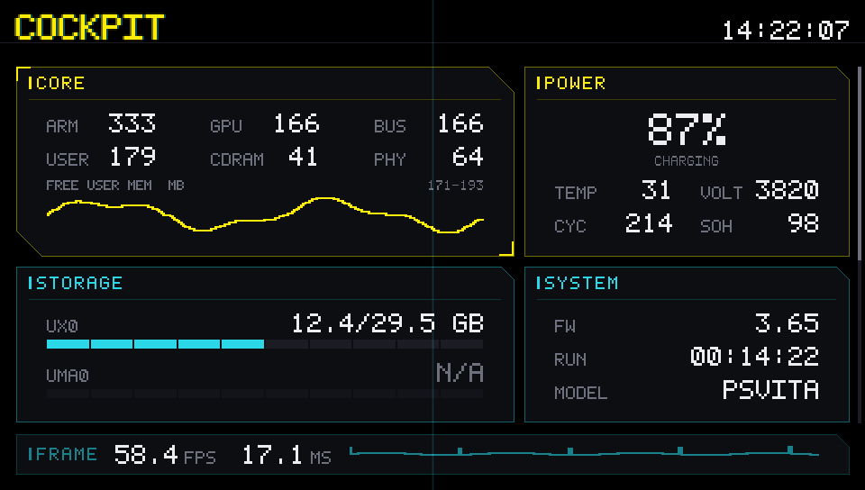
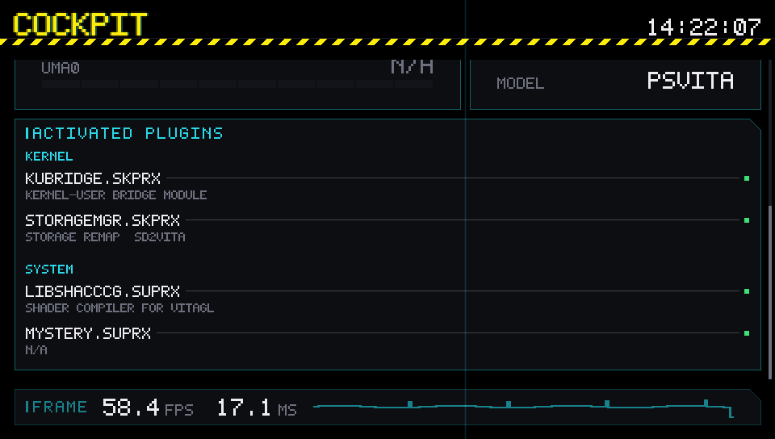

# PS Vita Homebrew

Three homebrew projects for a PS Vita on firmware **3.65 with permanent Enso
CFW**, plus the field notes and reference material they were built from. All of
it targets VitaSDK 2026.08 and libvita2d.



*COCKPIT, rendered by the host preview harness. The values are synthetic; the
layout and type are the shipped ones.*

> **Firmware note.** The console this was developed on reports **3.74** because
> its system version string is spoofed. The machine is genuinely on 3.65 Enso.
> NIDs, offsets and API availability follow 3.65; only the displayed string is
> 3.74.

## Projects

| Project | Status | What it is |
|---|---|---|
| [`vita-cockpit`](vita-cockpit/) | `verified` | A live system dashboard in Cyberpunk 2077 HUD style: clocks, memory, storage, power, identity, frame health, and the taiHEN plugins that are loaded. |
| [`vita-cap-test`](vita-cap-test/) | `built` | A capability test for file I/O, PCM audio, WiFi/DNS/HTTP, and the bundled libraries. |
| [`vita-kernel-demo`](vita-kernel-demo/) | `built` | A userland app that loads a real taiHEN `.skprx` on demand, hooks `ksceIoOpen`, and reads the hook state through a generated syscall stub. |

`verified` means it has run on the console. `built` means it compiles and
packages but has not been run on hardware yet. The live board, with the exact
next action for each project, is [`PROJECTS.md`](PROJECTS.md).

## Quick start

### Prerequisites

- A PS Vita on **3.65 Enso** (PSTV is not a target).
- **VitaSDK 2026.08** installed somewhere on the host.
- **VitaShell** on the console, for installation over FTP.
- **HENkaku Settings → Enable Unsafe Homebrew** enabled. Every project here
  ships an `UNSAFE` eboot; see [Safety](#safety).

`build.sh` finds the SDK in this order: `$VITASDK`, then `../vitasdk` relative
to the project, then `~/vitasdk`. Export it explicitly if yours lives elsewhere:

```sh
export VITASDK="$HOME/vitasdk"
export PATH="$VITASDK/bin:$PATH"
```

### Build

```sh
cd vita-cockpit     && ./build.sh   # dashboard
cd vita-cap-test    && ./build.sh   # capability test
cd vita-kernel-demo && ./build.sh   # app + kernel plugin
```

Each project emits one uniquely named artifact in its `build/` directory:

```text
build/cockpit-v01.00-b12.vpk
build/cap-test-v01.00-b4.vpk
build/kernel-demo-v01.00-b5.vpk
```

The build number identifies a **distinct** build, not a compiler invocation.
`build.sh` hashes the sources and reuses the previous number when nothing
changed, so rebuilding for a warning check does not inflate the counter. The
number lives in the project's `BUILD_NUMBER` file, never in `build/`, and the
directory is pruned to the single newest VPK. COCKPIT can also build the
restricted variant with `./build.sh --safe`.

### Install

Start VitaShell's FTP server (press **Select**) and send the newest VPK to the
console:

```sh
cd vita-cockpit && ./send.sh 192.168.1.42
```

The URL form is `ftp://<ip>:1337/ux0:/data/` — colon followed by slash. Then
install the VPK from `ux0:data` in VitaShell and launch the bubble.

## COCKPIT

The dashboard reads the machine it is running on and draws it as one live
instrument panel:

```text
CORE 552×210                 │ POWER 360×210
ARM 333  GPU 166  BUS 166    │              87%
USER 179 CDRAM 41 PHY 64     │          CHARGING
FREE USER MEM (MB) 171-193   │ TEMP 31  VOLT 3820
      ╱‾╲__╱‾╲__             │ CYC 214  SOH 98
─────────────────────────────┼────────────────────────────
STORAGE 552×172              │ SYSTEM 360×172
UX0            12.4/29.5 GB  │ FW            3.65
UMA0                  N/A    │ RUN     00:14:22
─────────────────────────────┴────────────────────────────
ACTIVATED PLUGINS
KERNEL
KUBRIDGE.SKPRX ────────────────────────────── ▪
kernel-user bridge module
SYSTEM
HENKAKU.SUPRX ─────────────────────────────── ▪
settings menu, version and update spoof
──────────────────────────────────────────────────────────
FRAME  58.4 FPS  17.1 MS   ─┼─────┼───┼───
```

| Input | Action |
|---|---|
| D-pad up/down, left stick | scroll the panel area |
| PS button | leave the app (system) |

The panel area scrolls because the content does not fit one screen; the header
and the `FRAME` strip stay pinned. The plugin ledger reads every activated entry
in `config.txt`, groups rows by load target — KERNEL, SYSTEM, SYSTEM APPS, ALL
TITLES, TITLES — and grows with the list. Descriptions cover 155 known taiHEN
plugins; a plugin outside the catalog still gets a row and says `N/A`, and a
commented-out entry is not shown.

<p align="center">
  
</p>

*Scrolled to the plugin ledger. Same host preview, same synthetic values.*

A number the platform cannot report renders `--`; it is never guessed or
substituted with zero. Storage uses `N/A` for an unmounted volume and `ERR xx`
for a refused read.

### Test and preview without hardware

```sh
cd vita-cockpit
./tools/test/run.sh      # 87 host checks against a fake port
./tools/preview/run.sh   # four 960×544 PNGs in build/preview/
```

The tests link the real sampling policy against a fake platform and assert the
alert boundary, failed-read handling, unit conversions, history ring, frame
floor, and the plugin table. The preview renders the shipped composition through
a software vita2d shim, so a PNG proves the policy ran. Neither replaces a
hardware run.

## Repository layout

```text
AGENTS.md            workspace operating contract: code rules, docs, safety
PROJECTS.md          live project board and job log
agent-wiki/          PS Vita knowledge base: toolchain, build, APIs, recovery
vita-cockpit/        system dashboard (src/, docs/, tools/)
vita-cap-test/       I/O + audio + network capability test
vita-kernel-demo/    userland app + taiHEN kernel plugin
gpu-crash-study/     analysis of the early GPU crashes that shaped the renderer
```

Each project has its own `README.md` and a `docs/` directory:
`PROJECT.md` (scope and status), `ARCHITECTURE.md` (layers and module
contracts), `DESIGN.md` (visual language, COCKPIT only), and `DECISIONS.md`
(numbered decisions with context and consequences).

## How the code is built

The workspace follows one rule: **source dependencies point inward, toward
policy**. The sampling policy in `vita-cockpit/core/` never includes a Vita
header, so it compiles and runs on a host against a fake platform. All SDK calls
for a concern live in one adapter — `platform/platform_psp2.c` is the only file
that samples the device, `gfx/draw.c` the only file that talks to vita2d.
`main()` constructs, nothing else does.

Platform behaviour that has not been confirmed on hardware is tagged `[C]` in a
comment, named, and isolated in the adapter, so a correction after a hardware
session is a one-file change. [`AGENTS.md`](AGENTS.md) is the full contract;
[`agent-wiki/13-fact-check.md`](agent-wiki/13-fact-check.md) records what is
verified and what is community-reported.

## Safety

This is homebrew for a console you own, and some of it runs with relaxed
permissions. Read this before installing:

- **`UNSAFE` eboots.** COCKPIT, the capability test, and the kernel demo's app
  all use `authid 0x2F00000000000001`, which is a system-wide permission
  relaxation. It is required: `uma0:` capacity needs `sceIoDevctl`, the
  capability test is deliberately exercising the full userland profile, and the
  kernel demo loads a kernel module. COCKPIT's `--safe` variant is
  `0x2F00000000000002`.
- **The kernel plugin is loaded on demand, never at boot.** It is not added to
  `*KERNEL` in `ur0:tai/config.txt`, so a reboot clears it. Do not add it until
  you have tested it and know your recovery path.
- **Do not edit `ur0:tai/boot_config.txt`.** A wrong entry can prevent boot; use
  the Enso installer's "fix boot config" option instead.
- **No Sony material is distributed here.** The repository contains no keys, no
  firmware, no game backups, and no SDK files. The toolchain is installed
  separately and ignored by git.

Recovery and crash-dump procedures are in
[`agent-wiki/07-debugging-recovery.md`](agent-wiki/07-debugging-recovery.md).

## What is not in this repository

| Path | Why |
|---|---|
| `vitasdk/` | ~494 MB toolchain. Install VitaSDK yourself; it is gitignored. |
| `*/build/` | Generated by `build.sh`; artifacts are gitignored. |
| `*.psp2dmp` | Core dumps are full copies of console process memory, including mapped system modules. Analysis input, not source. |
| `tools/psp2_gpucrash_parse/` | Third-party MIT project ([shoui520/psp2_gpucrash_parse](https://github.com/shoui520/psp2_gpucrash_parse)). Clone it when you need it; do not vendor it. |
| `user-files/` | A real console's `config.txt`, kept locally as a parser fixture. The tests build synthetic configs; the app never ships one. |

## Documentation

| Document | Contents |
|---|---|
| [`AGENTS.md`](AGENTS.md) | Workspace contract: dependency rule, documentation duties, hard safety rules |
| [`PROJECTS.md`](PROJECTS.md) | Status board and one-line job log |
| [`agent-wiki/README.md`](agent-wiki/README.md) | Knowledge base index and reading order |
| [`agent-wiki/00-quickstart.md`](agent-wiki/00-quickstart.md) | Install, build, upload, run |
| [`agent-wiki/03-build-pipeline.md`](agent-wiki/03-build-pipeline.md) | ELF → VELF → SELF → VPK |
| [`agent-wiki/06-kernel-plugins.md`](agent-wiki/06-kernel-plugins.md) | taiHEN hooks, custom syscalls, generated stubs |
| [`agent-wiki/13-fact-check.md`](agent-wiki/13-fact-check.md) | `[V]` verified vs `[C]` community claims |

## License

[MIT](LICENSE) © 2026 Upakul Talukdar.
