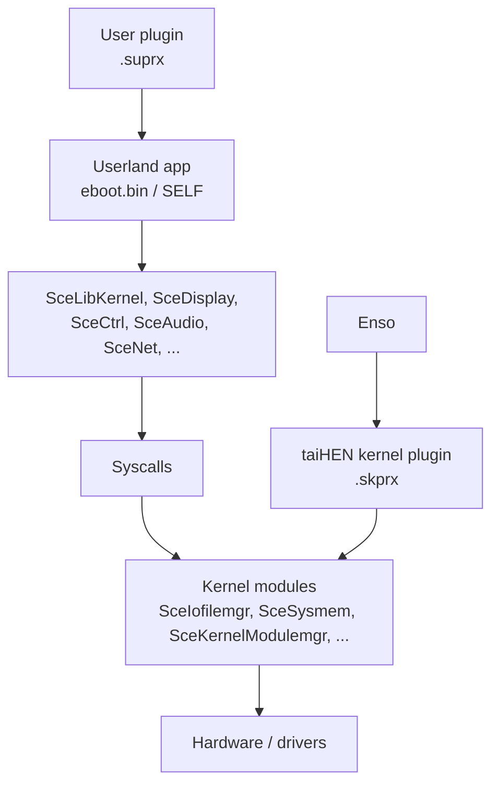

# 01 — Platform and Execution Model

## Hardware

| Component | PS Vita |
|---|---|
| CPU | Quad-core ARM Cortex-A9, ARMv7-A, NEON, VFPv3 |
| CPU clock | 333 MHz default; 444 MHz via `scePower`; 500 MHz only through unsupported register-level overclocking (not guaranteed) |
| GPU | PowerVR SGX543MP4+ |
| RAM | 512 MB main + 128 MB VRAM |
| Display | 960 × 544 |
| Input | Buttons, two analog sticks, front touch, rear touchpad, motion |
| Storage | Proprietary memory card; 1 GB internal on PCH-2000; game card; USB on PSTV |
| OS | Proprietary monolithic kernel with FreeBSD/NetBSD-derived components |
| Shell | LiveArea (`SceShell`) |

The Vita is not Android and does not run Linux binaries. It runs SCE modules in
Sony's ELF/SELF format with Sony's NID-based linking.

## Software layers



- **LiveArea / SceShell** is the home screen. It launches apps and draws bubbles.
- **SceAppMgr** manages application lifecycle.
- **ScePromoterUtil** installs/promotes packages (used by VitaShell).
- **SceLibKernel** is the userland wrapper around kernel services.
- **SceIofilemgr** handles file I/O and mounts.
- **SceSysmem** handles memory blocks.
- **SceKernelModulemgr** loads/starts/stops modules.

## Processes and threads

A normal app is a userland process with a main thread. `main()` is called by the
SDK startup code. Returning from `main()` or calling `sceKernelExitProcess(0)`
ends the process.

Apps can create threads with `sceKernelCreateThread` /
`sceKernelStartThread`, allocate memory with `sceKernelAllocMemBlock`, and call
Sony libraries through stubs.

## The executable chain

```text
C/C++ source
   │ arm-vita-eabi-gcc
   ▼
ELF (ET_EXEC)
   │ vita-elf-create
   ▼
VELF (ET_SCE_RELEXEC; module info + import/export tables)
   │ vita-make-fself [-c] [-s|-ss]
   ▼
FSELF / eboot.bin (SCE header + segments; unsigned)
   │ vita-mksfoex + vita-pack-vpk
   ▼
.vpk (ZIP)
```

- `.self` = application executable.
- `.suprx` = userland PRX/library/plugin.
- `.skprx` = kernel PRX/module/plugin.
- `.vpk` = community ZIP package; not a Sony package format.

## NIDs: why normal ARM binaries do not run

The Vita does not resolve imports by symbol name. Each exported function has a
32-bit **NID**. A module's import table lists library NIDs and function NIDs.

VitaSDK ships NID databases under:

```text
$VITASDK/share/vita-headers/db/360/
$VITASDK/share/vita-headers/db/363/
$VITASDK/share/vita-headers/db/0.931/
$VITASDK/share/vita-headers/db/0.990/
```

`vita-libs-gen` turns those databases into `libSce*_stub.a`. You link the stubs;
`vita-elf-create` builds the SCE import table.

Examples:

| Module | Function | NID |
|---|---|---|
| `SceIofilemgr` | `ksceIoOpen` | `0x75192972` |
| `SceIofilemgr` | `_sceIoOpen` | `0xCC67B6FD` |
| `SceLibKernel` | `sceIoOpen` | `0x6C60AC61` |
| `SceLibKernel` | `sceKernelExitProcess` | see DB |

NIDs are often stable across firmware, but **library NIDs, module NIDs, segment
layouts, and offsets are not guaranteed to be**. A 3.60 plugin is not
automatically a 3.65 plugin.

## Why the jailbreak is required

Retail SELFs are signed. Homebrew FSELFs are unsigned. HENkaku loads **taiHEN**,
which:

1. disables code signature checks for unsigned executables;
2. exposes kernel peek/poke and kernel module loading to userland;
3. provides function hooking/injection.

Enso makes taiHEN load at boot. Without a jailbreak, a VPK may install but the
app will not launch.

## Layers of control

| Layer | What you can do | How |
|---|---|---|
| **1. Normal app** | Install/run apps, UI, audio, network, own files, public APIs | VPK + VitaSDK, safe eboot |
| **2. Unsafe userland** | Full userland filesystem, private APIs, JIT, load kernel modules | `UNSAFE` eboot + Enable Unsafe Homebrew |
| **3. Kernel plugin** | Hook/patch kernel and apps, drivers, mounts, clock changes | `.skprx` + taiHEN |
| **4. Boot / CFW** | Permanent taiHEN at boot, boot-time plugins | Enso |

This wiki's kernel demo reaches **layer 3**: a user app loads a `.skprx`, the
plugin hooks a kernel export, and the app reads kernel state via a custom
syscall.

## What userland cannot do

- Raw-read the eMMC or block devices.
- Access protected system partitions such as `os0:`/`vs0:` freely.
- Patch kernel memory or code.
- Replace the hardware root of trust / signed boot chain.
- Control PSN's server side.

Those require a kernel plugin, and some require boot-level code.

## Firmware baseline

The assumed target is **3.65 Enso**. 3.60 is similar but has different module
NIDs/offsets for some system patches. 3.67/3.68 have no Enso; 3.69–3.74 use
h-encore²/HENlo and are usually downgraded to 3.65 for permanent CFW.

### The version string is spoofed to 3.74

This workspace's console **is on 3.65 Enso but reports 3.74**. The system
version string has been spoofed (a common step for store or update checks).

Consequences:

| Surface | Reports | Truth |
|---|---|---|
| `sceKernelGetSystemSwVersion()` | `3.74` | 3.65 |
| System UI / Settings | `3.74` | 3.65 |
| Module NIDs, offsets, loaded APIs | — | **3.65** |

So a version string is a *display* value, never evidence of the running
firmware. An app that prints the version will print 3.74; that is correct
behaviour, not a bug and not a reason to retarget. Resolve NIDs and offsets
against 3.65 regardless.

Do not "fix" a project because it displays 3.74.

See [08-firmware-jailbreak.md](08-firmware-jailbreak.md).
