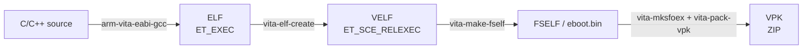

# 03 — Build Pipeline

## Overview



| Stage | Tool | Output | What changes |
|---|---|---|---|
| Compile/link | `arm-vita-eabi-gcc` | ELF | Normal ARM EABI, `-Wl,-q` relocation table |
| Sony ELF | `vita-elf-create` | VELF | Module info, export/import tables, `ET_SCE_RELEXEC` |
| SELF | `vita-make-fself` | FSELF / `eboot.bin` | SCE header, compression, authid, ASLR |
| Metadata | `vita-mksfoex` | `param.sfo` | Title ID, name, version, content ID |
| Package | `vita-pack-vpk` | `.vpk` | ZIP with `eboot.bin`, `sce_sys/param.sfo`, assets |

## `vita-elf-create`

```text
usage: vita-elf-create [-v|vv|vvv] [-n] [-e config.yml] input.elf output.velf
    -v,-vv,-vvv: logging verbosity
    -s         : strip the output ELF
    -n         : allow empty imports
    -e yml     : optional module/export config
    -g yml     : generate an export config from ELF symbols
    -m list    : module entrypoints
    -p         : skip stub privilege check
```

It converts `ET_EXEC` to `ET_SCE_RELEXEC` and adds:

- `.sceModuleInfo.rodata`
- `.sceLib.ent` / `.sceExport.rodata`
- `.sceLib.stubs` / `.sceImport.rodata`
- `.sceFNID.rodata` / `.sceFStub.rodata`
- `.sce.rel`

The resulting VELF can be inspected with:

```sh
arm-vita-eabi-readelf -h app.velf     # Type: OS Specific (fe04)
arm-vita-eabi-readelf -S app.velf     # .sce* sections
```

## `vita-make-fself`

```text
usage: vita-make-fself [-s|-ss|-a 0x...] [-c] [-na] input.velf output-eboot.bin
    -s  : safe eboot (restricted APIs/filesystem)
    -ss : secret-safe eboot (advanced)
    -a  : custom authid
    -c  : zlib-compress segments
    -na : disable ASLR
    -m  : memory budget in KiB
    -pm : physically contiguous budget in KiB
    -at : ATTRIBUTE word
```

Auth IDs:

| Build | Auth ID | Meaning |
|---|---|---|
| no flag (raw tool) | `0x2F00000000000001` | Full permissions |
| `-s` | `0x2F00000000000002` | Safe |
| `-ss` | `0x2F00000000000003` | Secret-safe |
| `-a 0x...` | custom | Advanced |

**Important:** the raw tool defaults to unsafe, but `vita_create_self()` in
CMake adds `-s` by default. It omits `-s` only when you pass `UNSAFE`.

The SCE header starts with magic `0x454353` (`SCE\0`), version 3. Auth ID is at
offset `0x80` in the FSELF.

## `vita-mksfoex`

```text
usage: mksfoex [options] TITLE output.sfo
    -d NAME=VALUE   Add a DWORD value
    -s NAME=STR     Add a string value
    -e, --empty     Do not add defaults
```

The 2026.08 tool writes these defaults (verified by parsing a generated SFO):

| Key | Default |
|---|---|
| `APP_VER` | `00.00` (raw tool; `vita_create_vpk` sets it to `VITA_VERSION`) |
| `ATTRIBUTE` | `0x8000` |
| `ATTRIBUTE2` | `0` |
| `ATTRIBUTE_MINOR` | `0x10` |
| `BOOT_FILE` | empty |
| `CATEGORY` | `gd` |
| `CONTENT_ID` | empty unless set |
| `EBOOT_APP_MEMSIZE` | `0` |
| `EBOOT_ATTRIBUTE` | `0` |
| `EBOOT_PHY_MEMSIZE` | `0` |
| `LAREA_TYPE` | `0` |
| `NP_COMMUNICATION_ID` | empty |
| `PARENTAL_LEVEL` | `0` |
| `PSP2_DISP_VER` | `00.000` |
| `PSP2_SYSTEM_VER` | `0` |
| `STITLE` | title |
| `TITLE` | title |
| `TITLE_ID` | 9-char ID |
| `VERSION` | `00.00` unless set |

Our CMake projects explicitly set `VERSION` and `CONTENT_ID`:

```cmake
set(VITA_MKSFOEX_FLAGS "${VITA_MKSFOEX_FLAGS} -s VERSION=${VITA_VERSION}")
set(VITA_MKSFOEX_FLAGS "${VITA_MKSFOEX_FLAGS} -s CONTENT_ID=HB0001-${VITA_TITLEID}_00-0000000000000000")
```

## `vita-pack-vpk`

```text
Usage: vita-pack-vpk [OPTIONS] output.vpk
  -s, --sfo=param.sfo     param.sfo
  -b, --eboot=eboot.bin   eboot.bin
  -a, --add src=dst       add file or directory
```

It always adds:

```text
sce_sys/param.sfo
eboot.bin
```

Then every `-a src=dst`. A VPK is a normal ZIP. Our test showed `param.sfo`
deflated and small files stored, which is normal libzip behavior.

## CMake macros

Include after `project()`:

```cmake
include("${VITASDK}/share/vita.cmake" REQUIRED)
```

### `vita_create_self`

```cmake
vita_create_self(target source
  [CONFIG file | GEN_EXPORTS file]
  [UNCOMPRESSED] [UNSAFE] [STRIPPED]
  [NOASLR] [REL_OPTIMIZE]
  [ATTRIBUTE attr] [MEMSIZE size] [MODULE_ENTRY "start,stop,exit"])
```

- Default: compressed (`-c`), safe (`-s`).
- `UNSAFE`: full permissions.
- The installed 2026.08 `vita.cmake` does **not** expose a `SECRETSAFE` option.
  To produce `-ss`, add `-ss` to `VITA_MAKE_FSELF_FLAGS` manually.
- `CONFIG`: YAML module/export config (required for kernel plugins with custom
  exports).
- `MEMSIZE`: KiB; normal apps leave it 0.
- `NOASLR`: reproducible crash addresses.

### `vita_create_vpk`

```cmake
vita_create_vpk(target titleid eboot
  [VERSION ##.##] [NAME "display name"]
  [FILE src dst] ...)
```

- Generates `param.sfo` with `vita-mksfoex`.
- Sets `APP_VER` and `TITLE_ID`.
- Adds `eboot.bin` and `sce_sys/param.sfo`.
- `FILE` can copy a directory recursively.

### `vita_create_stubs`

```cmake
vita_create_stubs(target-dir source config [KERNEL])
```

Runs `vita-elf-export` and `vita-libs-gen`, then builds and copies:

```text
lib<module-name>_stub.a
lib<module-name>_stub_weak.a
```

The module name is parsed from the **first line** of the YAML config. It must
start at column 0.

## Raw Makefile pipeline

The `libvita2d` sample is a compact reference:

```make
TITLE_ID = VITA2DTST
TARGET   = vita2dsample

LIBS = -lvita2d -lSceDisplay_stub -lSceGxm_stub \
       -lSceSysmodule_stub -lSceCtrl_stub -lScePgf_stub -lScePvf_stub \
       -lSceCommonDialog_stub -lfreetype -lpng -ljpeg -lz -lm -lc -lSceAppMgr_stub

all: $(TARGET).vpk

%.vpk: eboot.bin
	vita-mksfoex -s TITLE_ID=$(TITLE_ID) "$(TARGET)" param.sfo
	vita-pack-vpk -s param.sfo -b eboot.bin $@

eboot.bin: $(TARGET).velf
	vita-make-fself -s $< $@

%.velf: %.elf
	vita-elf-create $< $@

$(TARGET).elf: $(OBJS)
	arm-vita-eabi-gcc -Wl,-q -Wall -fno-lto $^ $(LIBS) -o $@
```

If you build outside CMake, you must add `-Wl,-q` yourself.

## CMake cache gotcha for multi-target projects

`vita_create_self()` stores `VITA_ELF_CREATE_FLAGS` and
`VITA_MAKE_FSELF_FLAGS` in **cache variables**. In a project with both a kernel
plugin and a user app, the kernel plugin's `CONFIG exports.yml` and `-s`/`-c`
flags leak into the app's `vita_create_self()`.

Fix before the second target:

```cmake
unset(VITA_ELF_CREATE_FLAGS CACHE)
unset(VITA_MAKE_FSELF_FLAGS CACHE)
set(VITA_ELF_CREATE_FLAGS "" CACHE STRING "vita-elf-create flags")
set(VITA_MAKE_FSELF_FLAGS "" CACHE STRING "vita-make-fself flags")
```

This is used in `vita-kernel-demo/CMakeLists.txt`.

## `__sce_headroom` (segment overlap)

As code grows, `vita-elf-create` can fail with:

```text
vita-elf-create: Cannot allocate N bytes for SCE data at end of segment 0; segment 1 overlaps
```

The linker script supports optional headroom:

```cmake
set(CMAKE_EXE_LINKER_FLAGS
    "${CMAKE_EXE_LINKER_FLAGS} -Wl,--defsym=__sce_headroom=0x10000")
```

This moves the RW segment to the next 64 KiB boundary with headroom. The VPK
stays small because the gap compresses.

## Target names on CMake ≥ 3.20

`vita_create_self(foo.self foo)` creates:

- `foo.self-self` custom target
- `foo.self` output file

`vita_create_vpk(foo.vpk ...)` creates:

- `foo.vpk-vpk` custom target
- `foo.vpk` byproduct

So dependencies must use `foo.self-self` / `foo.vpk-vpk`, not `foo.self` /
`foo.vpk`.

## Position-independent code

`vita-elf-create` rejects PIC/PIE relocations in some cases:

```text
vita-elf-create: Invalid relocation type 25!
```

Set:

```cmake
set(CMAKE_POSITION_INDEPENDENT_CODE OFF)
```

and avoid `-fPIC`/`-pie`.

## Verification commands

```sh
# ELF -> VELF type
arm-vita-eabi-readelf -h build/app.velf | grep Type
# expected: OS Specific: (fe04)

# VPK layout
unzip -l build/app.vpk
# expected: eboot.bin and sce_sys/param.sfo at root

# SELF authid
python3 - <<'PY'
import struct
d=open('build/app.self','rb').read(0x100)
print(hex(struct.unpack_from('<Q',d,0x80)[0]))
PY
```

## Our verified artifacts

| Project | ELF | VELF | SELF | VPK |
|---|---|---|---|---|
| `vita-cap-test` | — | — | 2.6 MB | 2.6 MB |
| `vita-kernel-demo` | — | — | 73 KB app | 74 KB |
| `vita-kernel-demo` | 4.8 KB `.skprx` | — | — | included in VPK |
