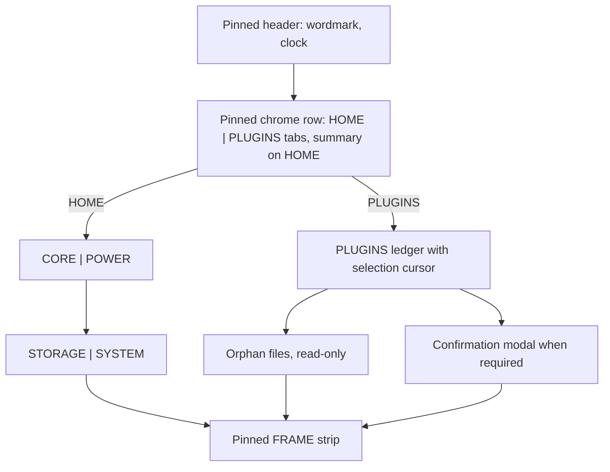
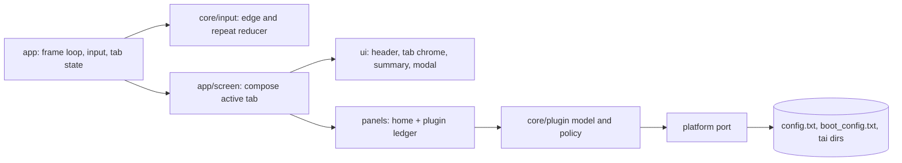
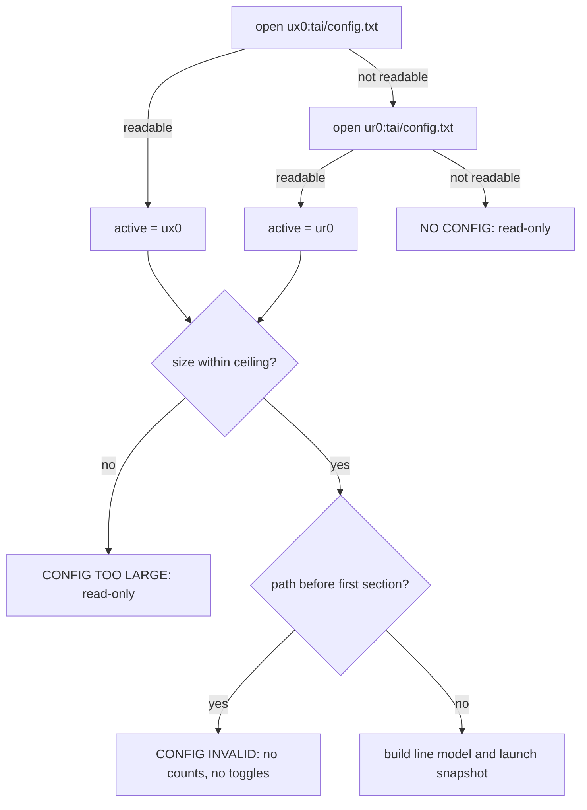
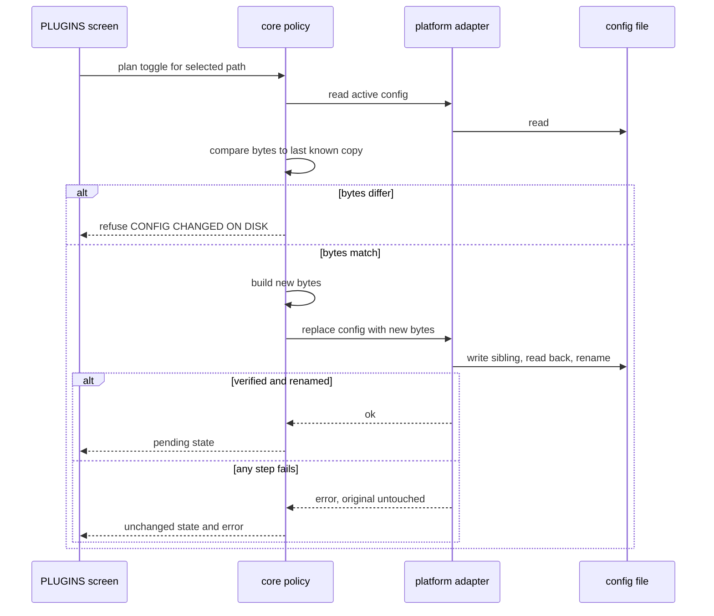
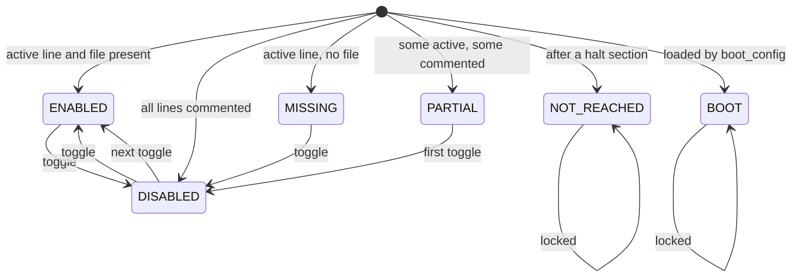

# Tabbed Plugin Manager - Plan

> **Partly superseded 2026-11-02.** The backup model (R33-R34), the three-state
> toggle (R12), and the summary placement (R4-R6) were replaced after the first
> hardware report. The summary moved from the header to a HOME block in D67. See
> `DECISIONS.md` D61-D67 and
> `2026-11-02-1430-fix-plugin-manager-regressions-plan.md`. This document stays
> as the record of the original design.

## Goal Capsule

- **Objective:** The console owner can read the machine on a dashboard that stays one screen, and change which taiHEN plugins load without leaving the console, while every displayed number still describes what the boot's config activated.
- **Means:** Split the interface into HOME and PLUGINS tabs switched with L/R. HOME keeps the instrument panels and gains a summary; PLUGINS carries the editable ledger.
- **Product authority:** This contract. It supersedes `vita-cockpit/docs/PROJECT.md` §1-2 (single screen, does not configure, writes nothing) and revisits `vita-cockpit/docs/DECISIONS.md` D16, whose single-writer metrics assumption a second screen now tests.
- **Execution profile:** Deep. Stop and re-plan if `sceIoRename` cannot replace an existing config on the target, or if a write cannot be verified by read-back.
- **Finishes:** `ce-work` implements and verifies on the host; the console owner performs the on-device check before the project returns to `verified`.
- **Open blockers:** None.

## Product Contract

**Product Contract preservation:** changed R4-R9, R11-R12, R15, R19-R21, R23, R31, R33 and added R25-R29 and R34. The changes clarify activated versus loaded, full-path row identity, config integrity, boot modules, storage-driver warnings, halt handling, session-scoped pending, and the three-deep session backup. No new product capability is added beyond the manager's existing promise; the safety rules are what R18 already requires.

### Summary

COCKPIT becomes two tabs. HOME stays a dashboard and shows a plugin summary in its pinned chrome row instead of the full ledger. PLUGINS is a full-screen, selectable ledger that enables or disables a plugin by editing its line in the active `config.txt`, with changes taking effect on the next boot.

### Problem Frame

The plugin ledger grows with the console. On the target configuration it is 1,581 px tall, more than three screens, so the instrument panels and the plugin list compete for the same scroll. The ledger is also read-only: removing a plugin means leaving COCKPIT for VitaShell or a PC, finding the right line, and commenting it out by hand.

That gap matters because the plugin list is the part of the dashboard a user is most likely to act on. Seeing that a plugin is activated and having no way to stop it makes the panel an inventory rather than an instrument. The cost is a context switch and a hand edit with no feedback about whether the file was written correctly.

### Key Decisions

- **The plugin screen is a manager, not a read-only viewer.** (session-settled: user-directed — chosen over a full-screen read-only ledger: the user wants to remove plugins from the console.) Governs R10-R18.
- **Each toggle writes the active config immediately and applies on the next boot.** (session-settled: user-directed — chosen over staging changes for one SAVE action: immediate per-row feedback matched the console workflow.) Governs R11, R23, R24.
- **Only entries already in the active config become rows; orphan files are listed read-only.** (session-settled: user-directed — chosen over adding unregistered files: the app must not choose a load target for a file that was never registered.) Governs R8, R21, R22.
- **`henkaku.suprx` is the only locked plugin entry; the warned plugins stay toggleable behind a confirmation.** (session-settled: user-directed — chosen over locking the warned group as well: a lock would remove the app's use as a troubleshooting tool.) The three boot modules are locked separately and are not plugin entries. Governs R13-R15, R20.
- **The home summary counts the activated set from launch, never the edited file.** (session-settled: user-directed — chosen over reflecting pending edits in the total: a count must not claim plugins that were not active in the running boot.) Governs R4-R6.
- **Pending is session-scoped.** (session-settled: user-directed — chosen over persisting a baseline: the platform has no reliable boot identity and the write is already durable.) Governs R6, R23.
- **Every session snapshots its config set with a three-deep backup rotation before any read or write.** (session-settled: user-directed — chosen over a single overwritten backup: the user wants three levels of undo.) The set is `ur0:tai/config.txt`, `ux0:tai/config.txt`, and `ur0:tai/boot_config.txt`; a future COCKPIT config file joins the same rule. Governs R33, R34.
- **The summary lives in the pinned chrome row beside the tabs.** A summary in the old ledger slot would sit entirely below the fold at scroll 0; the chrome row is always visible and costs no viewport height. Governs R4-R6.
- **Rows are identified by full path, not basename.** Two files with the same name in `ur0:tai` and `ux0:tai` are different files, and a toggle may only touch lines the user can see. Governs R8, R11, R12.
- **The active config is resolved the way taiHEN resolves it: `ux0` first, `ur0` fallback.** The running app currently reads `ur0` first, so a console with both files has been shown the shadowed copy. Governs R19.
- **The app never applies, reloads, or reboots.** A normal app cannot call taiHEN's reload, and kernel plugins are loaded once at boot, so the only honest promise is "next boot". Governs R24.
- **Boot modules are not toggles.** `taihen.skprx`, `henkaku.skprx`, and `yamt.skprx` load from `boot_config.txt` before taiHEN reads `config.txt`. Governs R20.

The two tabs share one pinned header and one pinned FRAME strip. Only the region between them changes.

### Requirements

**Navigation and home**

- R1. The app exposes two tabs, HOME and PLUGINS, with HOME active at launch.
- R2. L and R move to the previous and next tab, wrapping at the ends, on a button edge rather than every frame.
- R3. The header and the FRAME strip stay pinned on both tabs, and the chrome row shows both tab names with the active one distinguished and the L/R affordance named.
- R4. HOME shows a summary in the pinned chrome row with the total number of unique activated plugins and one count per non-empty load group, in the existing KERNEL, SYSTEM, SYSTEM APPS, ALL TITLES, TITLES order; the row uses the short labels KERNEL, SYSTEM, APPS, ALL, and TITLES when the full names do not fit.
- R5. The summary counts the launch config's activated set: a path is activated when at least one of its lines is enabled, its file exists, and its section is reached. A pending enable does not count until the reboot; a pending disable keeps counting until the reboot.
- R6. When the active config differs from the launch snapshot, HOME shows how many rows have pending changes and states that they apply on the next boot.
- R7. HOME and PLUGINS keep independent scroll positions and, on PLUGINS, independent selection for the life of the session.

**Plugin ledger**

- R8. PLUGINS lists every plugin path named in the active config, whether active or commented out, as one row per unique path, grouped by the most privileged line that names it.
- R9. A row shows its display name — the basename, or the full path when two rows share a basename — its catalog description or `N/A`, and exactly one status, evaluated in this order: BOOT when the path is loaded by `boot_config.txt` or is `taihen.skprx`, `henkaku.skprx`, or `yamt.skprx`; NOT REACHED when none of its lines is reached because of a `*!` halt; MISSING when no file exists at the path; PARTIAL when some lines are active and some commented; ENABLED when at least one line is active and the file exists; DISABLED when every line is commented. A row whose file is missing may be disabled but not enabled, except the `henkaku.suprx` restore. A change waiting for a reboot is marked separately from the status.
- R10. A visible selection cursor moves with up and down, the view scrolls to keep it visible, and Cross acts on the selected row.

**Toggle and safety**

- R11. A toggle sets every reached line that names the selected path to one target state: all commented when any reached line is active, all active when none is; it preserves each line's path text, section, order, and line ending, leaves unreached lines untouched, and changes no other byte of the file.
- R12. A path listed under several sections is one row and toggles as one unit; a PARTIAL row disables its remaining active lines on the first toggle, enables all of its lines on the second, and restores the launch line pattern on the third when the launch state was PARTIAL.
- R13. `henkaku.suprx` cannot be disabled; if any of its lines is commented when the screen opens, Cross enables all of its lines.
- R14. A locked row states why it is locked, and Cross on an enabled locked row changes nothing.
- R15. Each warned plugin requires a confirmation that names the consequence of the direction being applied: `0syscall6.skprx`, `nonpdrm.skprx`, `repatch.skprx`, `nopsmdrm.skprx`, `libshacccg.suprx`, `yamt.suprx`, `yamt_helper.skprx`, `reVitaMotion.suprx`, and the storage drivers `storagemgr.skprx`, `usbmc.skprx`, `usbmcm.skprx`; the storage drivers confirm in both directions because disabling one can remove `ux0:` at the next boot, and hold-L cannot recover a driver that is skipped.
- R16. Enabling any plugin filed under KERNEL requires a confirmation that names the boot risk and the hold-L recovery; when the plugin is also warned, one confirmation carries both messages.
- R17. A confirmation is modal: Cross accepts, Circle cancels, it captures input until then, and L/R does not switch tabs while it is open.
- R18. A failed write leaves the row in its previous state, shows that the write failed, and allows a retry; no row ever shows a change that was not written.

**Config handling**

- R19. The active config is `ux0:tai/config.txt` when it can be read, otherwise `ur0:tai/config.txt`; PLUGINS names the active path and, when both exist, names the ignored one.
- R20. The app never writes `ur0:tai/boot_config.txt` and never offers its modules as toggles; a boot module found in `config.txt` is a locked BOOT row.
- R21. Plugin files present in `ur0:tai` or `ux0:tai` that no path in the active config names, and that `boot_config.txt` does not load, are listed at the bottom of PLUGINS as read-only orphans with their full path; files in a shadowed directory are labelled as shadowed. When the active config was not fully parsed, or `boot_config.txt` cannot be read, the section marks exclusions as unverified rather than claiming a file is not loaded.
- R22. The orphan section states that those files are not loaded only when the active config was fully parsed and `boot_config.txt` was read; otherwise it says exclusions are unverified. It offers no toggle, add, or delete action.
- R23. A pending change is the difference between the current per-line active state and the launch snapshot; it survives tab switches and disappears when a later write restores the launch state.
- R24. The screen states that KERNEL changes need a reboot and user-mode changes need the affected title to be relaunched or a reboot; there is no apply, reload, or reboot action.
- R25. A readable empty config is valid and active; it is not treated as absent.
- R26. A config that exceeds the read ceiling or cannot be read is shown read-only with the reason, and no toggle is offered.
- R27. If the active config's bytes differ from the last known on-disk copy when a toggle is attempted, the app refuses the write, keeps the row unchanged, and tells the user to restart COCKPIT. The last known copy starts as the launch snapshot and becomes the bytes the app last wrote after each verified write.
- R28. A `*!Section` header is a halt point; paths after it are NOT REACHED, are not counted, and are read-only. A toggle leaves every unreached line untouched, and a path with at least one reached line is managed through those reached lines.
- R29. A path before the first section header makes the config invalid; the app shows a config-invalid state with no counts and no toggles.

**Effect and evidence**

- R30. Host tests cover config resolution, line-preserving toggles, full-path identity, multi-section files, statuses, pending detection, lock and warn policy, boot-module exclusion, halt handling, truncation, three-deep backup rotation, and write failure.
- R31. The host preview renders nine states: HOME, HOME alert, HOME with pending changes, HOME with five groups, PLUGINS, PLUGINS with duplicate basenames, a warned confirmation, a write failure, and a read-only config state.
- R32. The project docs are updated in the same change: `PROJECT.md` scope and non-goals, `DESIGN.md` tabs and summary, `ARCHITECTURE.md` new seams and writer rules, `DECISIONS.md` with a new tab-aware state decision and a revisit of D16, the README controls table, `PROJECTS.md`, and the wiki.
- R33. Before replacing the active config, the app verifies that the active config's pre-session backup exists and matches the bytes read at session start; a missing or mismatched backup aborts the write and leaves the original untouched.
- R34. At session start, before the config is read or any write, the app rotates three verified backups for every existing file in its config set: `<path>.bak` holds the pre-session bytes, `<path>.1.bak` the previous session, and `<path>.2.bak` the session before that. If the active config's backup cannot be written or verified, the manager is read-only for that session and names the file; a failure on another file in the set is a warning.

### Key Flows

- F1. Switch tabs
  - **Trigger:** The user presses L or R on either tab.
  - **Steps:** The active tab changes, the destination redraws with its own scroll and selection, and the header, chrome row, and FRAME strip stay in place.
  - **Covers:** R1-R3, R7.
- F2. Toggle a safe plugin
  - **Trigger:** The user selects an ENABLED, DISABLED, or PARTIAL row and presses Cross.
  - **Steps:** The policy layer builds the new file bytes, the adapter writes and verifies them, and the row shows the pending state for the next boot.
  - **Covers:** R10-R12, R23.
- F3. Toggle a warned plugin
  - **Trigger:** The user presses Cross on a warned row.
  - **Steps:** A modal names the consequence; Cross confirms and writes, Circle leaves the row unchanged.
  - **Covers:** R15, R17, R18.
- F4. Attempt a locked row
  - **Trigger:** The user presses Cross on `henkaku.suprx` while it is fully enabled.
  - **Steps:** The row states that it is locked and nothing is written.
  - **Covers:** R13, R14.
- F5. Restore an already-disabled lock
  - **Trigger:** The screen opens with some or all `henkaku.suprx` lines commented out.
  - **Steps:** The row is locked against further disabling but Cross enables all of its lines.
  - **Covers:** R13.
- F6. Write failure
  - **Trigger:** The file cannot be written, verified, or renamed.
  - **Steps:** The original file remains untouched, the row returns to its previous visual state, an error is shown, and the toggle can be retried.
  - **Covers:** R18.
- F7. Read the home summary
  - **Trigger:** HOME is active.
  - **Steps:** The chrome row shows the activated total, per-group counts, and any pending line, all from the launch snapshot.
  - **Covers:** R4-R6.
- F8. External config change
  - **Trigger:** The file changes on disk between launch and a toggle.
  - **Steps:** The toggle is refused with `CONFIG CHANGED ON DISK`, the row stays unchanged, and the screen asks for a restart of COCKPIT.
  - **Covers:** R27.
- F9. Read-only config
  - **Trigger:** The active config is too large, invalid, or unreadable.
  - **Steps:** The screen states which condition applies, shows no false counts, and offers no toggle for the affected rows. A readable empty config is not this case.
  - **Covers:** R25, R26, R29.
- F10. Orphan listing
  - **Trigger:** PLUGINS opens.
  - **Steps:** Files in either tai directory that are absent from the active config and from `boot_config.txt` appear in a read-only section with their full path; when the config or boot file was not fully read, the section says exclusions are unverified instead.
  - **Covers:** R21, R22.

### Acceptance Examples

- AE1. Home after a toggle
  - **Covers R4-R6, R23.**
  - **Given:** HOME reports 19 activated plugins and PLUGINS disables one.
  - **When:** The user returns to HOME.
  - **Then:** The total is still 19 and the pending line says one change applies on the next boot.
- AE2. KERNEL enable
  - **Covers R16.**
  - **Given:** A KERNEL row is DISABLED.
  - **When:** The user presses Cross.
  - **Then:** A confirmation names the boot risk and hold-L recovery before anything is written.
- AE3. Multi-section path
  - **Covers R11, R12.**
  - **Given:** One path appears under `*main` and `*NPXS10015`.
  - **When:** The user disables it.
  - **Then:** One row remains, both lines are commented, and the row is marked pending.
- AE4. Locked but already off
  - **Covers R13, R14.**
  - **Given:** All `henkaku.suprx` lines are commented out.
  - **When:** The user presses Cross.
  - **Then:** Every line is enabled, because the lock forbids disabling, not restoring.
- AE5. Two config files
  - **Covers R19.**
  - **Given:** Both `ux0:tai/config.txt` and `ur0:tai/config.txt` exist.
  - **When:** PLUGINS opens.
  - **Then:** The screen names `ux0` as active and `ur0` as ignored, and edits only `ux0`.
- AE6. Write failure
  - **Covers R18.**
  - **Given:** The write, verification, or rename fails.
  - **When:** The user toggles a row.
  - **Then:** The original file is unchanged, the row shows its previous state and an error, and no pending marker appears.
- AE7. Orphan file
  - **Covers R21, R22.**
  - **Given:** `ur0:tai/extra.skprx` exists but no config line names it.
  - **When:** PLUGINS opens.
  - **Then:** It appears in a read-only orphan section that says it is not loaded, and Cross does nothing.
- AE8. Missing file
  - **Covers R9.**
  - **Given:** A config line names a file that is not on disk.
  - **When:** PLUGINS opens.
  - **Then:** The row is MISSING, it is not counted as activated, and it may be disabled but not enabled.
- AE9. Config changed on disk
  - **Covers R27.**
  - **Given:** The file is edited externally after launch.
  - **When:** The user presses Cross on a row.
  - **Then:** The toggle is refused, nothing is written, and the screen asks for a reopen.
- AE10. Empty active config
  - **Covers R25.**
  - **Given:** `ux0:tai/config.txt` exists and is zero bytes, and `ur0:tai/config.txt` has entries.
  - **When:** PLUGINS opens.
  - **Then:** `ux0` is active with zero rows; `ur0` is named as ignored.
- AE11. Config too large
  - **Covers R26.**
  - **Given:** The active config exceeds the read ceiling.
  - **When:** PLUGINS opens.
  - **Then:** The screen is read-only with `CONFIG TOO LARGE`, and no toggle is offered.
- AE12. Halt section
  - **Covers R28.**
  - **Given:** A `*!ALL` header appears before a path.
  - **When:** PLUGINS opens.
  - **Then:** That path is NOT REACHED, is not counted, and Cross does nothing.
- AE13. Storage driver disable
  - **Covers R15.**
  - **Given:** `storagemgr.skprx` is an enabled KERNEL row.
  - **When:** The user presses Cross.
  - **Then:** A confirmation names the loss of `ux0:` at the next boot and a recovery path that does not rely on hold-L.
- AE14. Second toggle in one session
  - **Covers R18, R27.**
  - **Given:** One toggle has already been written and verified.
  - **When:** The user toggles another row.
  - **Then:** The write proceeds against the last known bytes, and the pending count becomes two.

### Success Criteria

- On the console, L/R switches tabs without moving the header or FRAME strip, and each tab returns to its own scroll position.
- The home total and group counts match the launch config's activated set, including during a session with pending edits.
- A toggle survives a reboot: a disabled plugin is absent from the next boot's activated set, and an enabled one is present when its file exists.
- `henkaku.suprx` cannot be disabled from the app, and a partially or fully disabled copy can be restored from it.
- A toggle changes only the comment markers on the selected path's lines; every other byte of the config is identical.
- Every successful toggle leaves the verified three-deep backup set in place; a failed session backup makes the manager read-only before any edit.
- No write occurs without an explicit Cross on a row, and a failed write never appears as a successful toggle.
- With the ledger gone, HOME fits the viewport without a scrollbar at its default state.
- Host tests pass, the preview renders all nine states, and the busiest tab stays under 5,500 draw calls.

### Scope Boundaries

**Deferred for later**

- A third tab or a configurable tab set.
- Search, filter, or sort inside the plugin ledger.
- Batch toggle, presets, or profiles.
- Adding an unregistered file to the config, or choosing a load target for it.
- Acting on orphans beyond listing them.
- A config diff, backup browser, restore, or undo history.
- An in-app reload, reboot, or shutdown action.
- Per-title plugin attribution beyond the existing section grouping.
- Persisting the launch baseline across an app relaunch before the reboot; the current plan treats pending as session-scoped.

**Deferred to Follow-Up Work**

- An in-app restore-from-backup action; the backup is created by every write, but restoring it remains a manual file operation in this version.

**Outside this product's identity**

- Editing `boot_config.txt` or any Enso boot file.
- Installing, deleting, or downloading plugin files.
- Network access or a plugin catalog fetch.

### Dependencies and Assumptions

- taiHEN reads `ux0:tai/config.txt` first and falls back to `ur0:tai/config.txt`; this is the precedence the manager must copy, even though the current app does the reverse.
- The config is a UTF-8 text file whose plugin entries are one path per line, whose section headers begin with `*`, and whose comments begin with `#`.
- Section names are case-sensitive; `*!Section` halts parsing; a path before the first section makes the config invalid.
- The read ceiling is 32 KiB, shared by the reader and the parser; a config larger than that is read-only with `CONFIG TOO LARGE`.
- Pending state is session-scoped: relaunching COCKPIT before the reboot re-reads the edited file as the new launch baseline, so HOME would then describe the edited set until the next reboot.
- The storage-driver names `storagemgr.skprx`, `usbmc.skprx`, and `usbmcm.skprx` come from community install guides `[C]`; they are warned by name, and a driver under a different name is not covered by that warning.
- The app already ships an unsafe eboot, so writing under `ur0:tai` is permitted.
- The host harness can present a writable fake filesystem with failure injection so toggle, pending, and failure paths are testable without hardware.
- The console can list both tai directories; the current port has no directory listing, so that capability is added rather than assumed.
- The app reads `boot_config.txt` with a dedicated reader to exclude boot-loaded modules from the orphan list; it never writes that file, and its session backup is a sibling copy.
- The backup set is `ur0:tai/config.txt`, `ux0:tai/config.txt`, and `ur0:tai/boot_config.txt`; a future COCKPIT config file joins the same rotation.
- No hardware is reachable from the development environment; every on-console behavior in Success Criteria is verified by the user.

### Sources and Research

- `vita-cockpit/src/core/plugins.c` — current parser, config order, commented-line and missing-file handling.
- `vita-cockpit/src/app/screen.c`, `vita-cockpit/src/app/app.c` — single screen entry point and scroll ownership.
- `vita-cockpit/docs/DECISIONS.md` — D15, D16, D47, D50-D53.
- `agent-wiki/09-community-field-notes.md` — `[V]` config format, path precedence, case-sensitive sections, `*!` halt, and `boot_config.txt` separation.
- [taiHEN README](https://github.com/yifanlu/taiHEN/blob/master/README.md) — section semantics and multiple-section entries.
- [taiHEN `plugin.h`](https://github.com/yifanlu/taiHEN/blob/master/plugin.h) — `ux0` config path and `ur0` recovery path.
- [Enso FAQ](https://enso.henkaku.xyz/) — hold L to skip plugin loading.
- [YAMT README](https://github.com/SKGleba/yamt-vita) — `yamt.skprx` belongs in `boot_config.txt`.
- [h-encore default config](https://github.com/TheOfficialFloW/h-encore/blob/master/bootstrap/bootstrap.c) — `henkaku.skprx` is hard-coded and `henkaku.suprx` is the user-mode companion.
- `vitasdk/arm-vita-eabi/include/psp2/io/fcntl.h`, `psp2/io/dirent.h` — write, rename, remove, and directory-listing declarations.
- Machine-local research notes, best effort while the session exists: `/var/folders/mg/zkjyjgms6_d_s_sk2lp62yhr0000gn/T/compound-engineering-501/ce-brainstorm/tabs-and-plugins/plugin-safety.md` and `grounding.md`, and `/var/folders/mg/zkjyjgms6_d_s_sk2lp62yhr0000gn/T/compound-engineering-501/ce-plan-research/d13cbad2/repo-research.md` and `spec-flow.md`. A missing copy is not a blocker; this contract governs.

---

## Planning Contract

### High-Level Technical Design

The change crosses four layers: the app owns tab and input state, the screen composes the active tab, the panels draw, the core owns plugin policy, and the platform adapter owns every file operation. No panel and no policy module touches the SDK.

Config resolution happens once when the screen opens. The result decides whether editing is possible at all.

A toggle never truncates the live file in place. The adapter writes a sibling, verifies it, and replaces the original only after the bytes match.

Row status is a file-state machine, not a running-process observation. A pending marker is a second, independent flag.

A path whose launch state was PARTIAL restores that pattern on the third toggle (R12), which is the only way a pending marker can clear without a reboot for that row.

### Key Technical Decisions

- KTD1. **One screen composer, explicit tab state.** `screen_draw` takes a read-only UI state that carries the active tab, both scroll offsets, the selection path, and the modal state. The app owns the mutable copy; the preview supplies a fixed one. This replaces the single `scroll` float without letting panels see navigation state.
- KTD2. **Input is reduced before it reaches the app.** A core module turns the pad snapshot plus elapsed time into edge-triggered events with a repeat delay for up and down. Cross, Circle, L, and R are edge-only. The modal consumes events first, so the press that opens it cannot also accept it.
- KTD3. **The config is a byte-preserving line model.** Every line keeps its raw span, line ending, section, path, and active flag. Rows are keyed by a normalized, case-insensitive full path. The parser is case-sensitive, honours `*!` halts, and rejects a path before the first section. The existing basename merge is removed.
- KTD4. **The launch snapshot is frozen state, and the last known copy follows writes.** The snapshot holds the active path, the launch bytes, the per-line active map, and the activated set. The last known copy starts as the launch bytes and is replaced by the bytes the app last wrote. Pending is a per-line active-state diff against the snapshot, not a byte diff. A toggle re-reads the file and refuses if the bytes differ from the last known copy.
- KTD5. **Config resolution distinguishes four outcomes.** Absent, empty-but-readable, too-large, and invalid are separate states. An empty `ux0` file is active. A too-large or invalid file is read-only. The active path is frozen at launch. The read ceiling is one shared 32 KiB constant used by both the reader and the parser.
- KTD6. **Writes are transactional, backed up, and verified.** Before the config scan, the adapter rotates the session backups: it copies `<path>.bak` to `<path>.1.bak`, `<path>.1.bak` to `<path>.2.bak`, and the current file to `<path>.bak`, verifying each copy by read-back. A failure on the active config makes the manager read-only; a failure on another file is a warning. The write path then removes a stale `.new` sibling, writes a fresh sibling with create-and-exclusive, closes it, reads it back, compares the bytes, confirms the active config's `.bak` matches the session-start bytes, and renames the sibling over the original. If any step fails, the original is untouched, the verified backup remains, and the write reports failure. The rename-original-away swap is not used; direct rename-over is the only replacement. The rename-overwrite behaviour is `[C]` until the console check.
- KTD7. **Policy owns the lock and warn tables.** `henkaku.suprx` is locked; the warned files carry per-direction messages. `taihen.skprx`, `henkaku.skprx`, and `yamt.skprx` are also locked by name as boot modules, so a config entry cannot toggle them even when `boot_config.txt` is unreadable. The storage drivers `storagemgr.skprx`, `usbmc.skprx`, and `usbmcm.skprx` are warned in both directions. The table lives in core, not in a panel, so the confirmation text and the toggle decision cannot drift.
- KTD7. **Policy owns the lock and warn tables.** `henkaku.suprx` is locked; the warned files carry per-direction messages. `taihen.skprx`, `henkaku.skprx`, and `yamt.skprx` are also locked by name as boot modules, so a config entry cannot toggle them even when `boot_config.txt` is unreadable. The storage drivers `storagemgr.skprx`, `usbmc.skprx`, and `usbmcm.skprx` are warned in both directions. The table lives in core, not in a panel, so the confirmation text and the toggle decision cannot drift.

Confirmation copy, written for the font's glyph set:

| File | Disabling | Enabling |
|---|---|---|
| `0syscall6.skprx` | HIGHER FIRMWARE GAMES MAY FAIL C1-6703-6 | PATCHES FIRMWARE AND KEY CHECKS AGAIN |
| `nonpdrm.skprx` | NONPDRM INSTALLS FAIL LICENCE CHECKS | NONPDRM LICENCES RETURN |
| `repatch.skprx` | MODS IN UX0:REPATCH STOP LOADING | MODS LOAD AGAIN |
| `nopsmdrm.skprx` | PSM TITLES FAIL LICENCE CHECKS | PSM LICENCES RETURN |
| `libshacccg.suprx` | VITAGL HOMEBREW MAY FAIL TO START | SHADER COMPILER LINE RETURNS |
| `yamt.suprx` | YAMT STORAGE MENU DISAPPEARS | YAMT STORAGE MENU RETURNS |
| `yamt_helper.skprx` | YAMT REMOUNT COMMANDS FAIL | YAMT REMOUNT COMMANDS RETURN |
| `reVitaMotion.suprx` | REVITA GYRO REMAPPING STOPS | REVITA GYRO REMAPPING RETURNS |
| `storagemgr.skprx` | UX0 MAY NOT MOUNT NEXT BOOT. RECOVER WITH CARD OR PC | THE STORAGE DRIVER LOADS AGAIN |
| `usbmc.skprx` | UX0 MAY NOT MOUNT NEXT BOOT. RECOVER WITH CARD OR PC | THE STORAGE DRIVER LOADS AGAIN |
| `usbmcm.skprx` | UX0 MAY NOT MOUNT NEXT BOOT. RECOVER WITH CARD OR PC | THE STORAGE DRIVER LOADS AGAIN |

Locked-row copy: `HENKAKU.SUPRX IS THE HENKAKU SETTINGS AND RELOAD UI. IT CANNOT BE DISABLED HERE.`
- KTD8. **The tab chrome and summary share the header, not a new band.** `ui/tabbar` draws the two tab labels in the header row between the wordmark and the clock, at y 16-44, in label scale with a 2 px active underline. On HOME it draws the activated total and group counts on the hazard line at y 48-60 in micro scale; a fault replaces the summary with the hazard band, and the tabs remain. No viewport height changes.
- KTD9. **Orphans come from the adapter, not from the config.** The adapter lists both tai directories and skips the transaction artefacts `.new`, `.bak`, `.1.bak`, and `.2.bak`; policy excludes every path named in the active config and every path loaded by `boot_config.txt`. A file in a shadowed directory is labelled shadowed, not silently promoted.
- KTD10. **The boot config has its own reader.** It parses `- load` lines only, returns a set of paths, and is read-only. It never reuses the plugin config parser.
- KTD11. **No new library and no new draw primitive.** The work uses `vita2d_draw_rectangle` and `draw_line` through the existing draw layer. Confirmation copy must fit the font's character set, which has no parentheses, comma, question mark, exclamation mark, or apostrophe.

### Assumptions

- `sceIoRename` over an existing file may not replace it on every Vita filesystem; if it does not, the write fails without touching the original, and the verified backup remains.
- The active config is small enough to hold in memory and rewrite whole; the 32 KiB ceiling exists to detect the case where it is not.
- The tai directories are readable even when the config is not.
- The fake platform can model absent, empty, too-large, unreadable, changed-on-disk, failed-backup, and failed-rename states without changing the real adapter's interface.

### Alternatives Considered

- **Summary as a panel in the old ledger slot.** Rejected: the slot starts at screen y 482, below the 472 viewport, so the summary would be invisible at launch and would push HOME into a long scroll again.
- **Edit the config in place with truncate-and-write.** Rejected: a failure at the wrong moment leaves a partial config, and the plan cannot promise R18's rollback. The transactional path costs one sibling file and one rename.
- **Keep basename identity and merge same-named paths.** Rejected: it lets a toggle comment a line in a directory the user never saw. Full-path identity is the only way "one row per file" and "every line that names it" can both be true.
- **A single SAVE action after staging toggles.** Rejected during the brainstorm: the user chose immediate write per row.

### Risks and Mitigations

| Risk | Mitigation |
|---|---|
| `sceIoRename` does not replace an existing file on the target filesystem `[C]` | The write fails without touching the original, and the verified backup remains |
| A backup write fails before the replace | A failure on the active config makes the manager read-only; a failure on another file is a warning |
| A `.bak` rotation runs out of space or hits a read-only directory | The active config's backup fails closed; other files warn, and no config write occurs without the active backup |
| A stale `.new` sibling survives an interrupted write and blocks the next create | The adapter removes a stale sibling before each transaction; a failed remove is reported |
| `ur0:tai` write is refused despite the unsafe eboot | The write fails without touching the original; the row and error state are explicit |
| The config changes externally between launch and a toggle | Re-read before every plan and refuse with `CONFIG CHANGED ON DISK`; tell the user to restart COCKPIT |
| A storage driver is a config entry, not a boot module | `storagemgr.skprx`, `usbmc.skprx`, and `usbmcm.skprx` warn in both directions and name a recovery path that does not rely on hold-L |
| Input repeat writes twice or a modal accepts its own opening press | Edge reducer, repeat delay, modal-first event consumption, and host tests for both |
| The header row cannot hold tabs, clock, and summary at once | Tabs sit between the wordmark and clock; the summary shares the hazard line; group counts drop from TITLES upward before the total or pending token |
| A long config exceeds the read ceiling | The config is read-only with `CONFIG TOO LARGE`; no truncated rewrite is possible |
| Confirmation copy exceeds the font's character set or the modal width | Copy is constrained to the font and wrapped by the modal; the preview catches overflow |

### Sequencing

U2 provides the read outcomes and the write path. U1 owns config resolution and the launch snapshot on top of it. U3 follows U1. U4 is independent. U5 and U6 depend on U2, U3, and U4. U7 depends on U2, U3, and U6. U8 closes the work after every other unit.

---

## Implementation Units

### U1. Byte-preserving config model, resolution, and launch snapshot

- **Goal:** Resolve the active config the way taiHEN does, then parse it and `boot_config.txt` into models that preserve bytes, expose line state, and identify rows by full path.
- **Requirements:** R8, R9, R19-R21, R23, R25-R29.
- **Dependencies:** U2.
- **Files:** `vita-cockpit/src/core/plugin_config.h` (new), `vita-cockpit/src/core/plugin_config.c` (new), `vita-cockpit/src/core/plugins.h`, `vita-cockpit/src/core/plugins.c`, `vita-cockpit/CMakeLists.txt`, `vita-cockpit/tools/test/test_plugin_config.c` (new), `vita-cockpit/tools/test/run.sh`.
- **Approach:**
  - Call U2's session-backup rotation before resolving the active config, so every config in the set is snapshotted before the first read.
  - Read `ux0` through U2's read result, then `ur0`; freeze the active path, launch bytes, per-line active map, and activated set.
  - Represent each line as a raw span plus parsed fields: offset, length, line ending, section, path, and active flag.
  - Parse section headers case-sensitively; `*!Name` sets a halt flag; a path before the first header marks the config invalid.
  - Key rows by normalized, case-insensitive full path. Merge only lines that name the same path.
  - Parse `boot_config.txt` separately by reading the path after a `load` token.
  - Keep the old `plugins.h` API only where the panels still need it; remove the basename merge.
- **Patterns to follow:** `vita-cockpit/src/core/plugins.c` parser loop and `vita-cockpit/src/core/metrics.c` fixed-size test style.
- **Test scenarios:**
  - `ux0` wins when both configs are readable; `ur0` is used when `ux0` is absent.
  - An empty `ux0` config is active and shadows a populated `ur0`.
  - A config with two sections and three paths yields three rows, each with the right section and line index.
  - A path repeated under two sections yields one row with two line references.
  - Two different paths with the same basename yield two rows.
  - A commented path is a DISABLED row; a comment that is not a plugin path is ignored.
  - A path before the first header makes the config invalid and yields no counts.
  - A `*!ALL` header makes later paths NOT REACHED and excludes them from the activated set.
  - Lowercase `*all` does not match `*ALL`, because section names are case-sensitive.
  - CRLF line endings survive a parse and a simulated toggle byte-for-byte.
  - A config at the 32 KiB ceiling parses; one byte over reports too-large.
  - A zero-byte config parses as valid with zero rows.
  - A boot config with `- load` lines yields the boot module set and ignores other lines.
  - An unreadable boot config yields an unverified-exclusion state, not an empty boot set.
  - A failed session backup stops resolution and leaves the manager read-only.
- **Verification:** `./tools/test/run.sh` passes the new model tests; a byte-comparison test shows every non-toggled byte unchanged.

### U2. Platform adapter: read result, transactional write, directory listing

- **Goal:** Extend the port so the policy layer can distinguish read outcomes, replace a config safely, and list the tai directories.
- **Requirements:** R18, R19, R21, R25-R27, R33, R34.
- **Dependencies:** None.
- **Files:** `vita-cockpit/src/core/platform.h`, `vita-cockpit/src/platform/platform_psp2.c`, `vita-cockpit/CMakeLists.txt`, `vita-cockpit/tools/fake/fake_platform.h`, `vita-cockpit/tools/fake/fake_platform.c`, `vita-cockpit/tools/test/test_platform.c` (new), `vita-cockpit/tools/test/run.sh`.
- **Approach:**
  - Add a session-backup call that rotates `<path>.bak` to `<path>.1.bak`, `<path>.1.bak` to `<path>.2.bak`, then copies the current file to `<path>.bak`, verifying each copy by read-back; skip a file that does not exist.
  - Replace the read integer with a result that reports absent, empty, ok, too-large, or unreadable.
  - Add a transactional write call that removes a stale `.new`, writes a sibling with create-and-exclusive, reads it back, compares the bytes, confirms the active `.bak` matches the session-start bytes, then renames the sibling over the original.
  - Add a directory-listing call that yields names and file sizes without exposing `SceUID` or `SceIoDirent` through the port.
  - Keep every SDK call inside `platform_psp2.c`.
- **Patterns to follow:** `platform_read_config` and `platform_file_exists` in `vita-cockpit/src/platform/platform_psp2.c`.
- **Test scenarios:**
  - Absent file reports absent; empty file reports empty; readable file reports ok with bytes.
  - A file at the ceiling reports ok; one byte over reports too-large.
  - A successful replacement writes the new bytes and leaves no `.new` sibling.
  - A session rotation moves the previous `.bak` to `.1.bak`, `.1.bak` to `.2.bak`, and writes the current bytes to `.bak`.
  - A rotation on a path with no existing backups creates `.bak` and skips the missing levels.
  - A rotation failure on the active config leaves the manager read-only and names the file; a failure on another file is a warning.
  - A write aborts when the active `.bak` is missing or does not match the session-start bytes.
  - A failed sibling write leaves the original bytes unchanged.
  - A failed read-back leaves the original bytes unchanged and removes the sibling.
  - A failed rename leaves the original bytes unchanged and keeps the backup.
  - A listing returns only regular files with the plugin extensions, skips directories, and omits the `.new`, `.bak`, `.1.bak`, and `.2.bak` artefacts.
  - A pre-existing `.new` sibling is removed before a successful write.
  - A failed remove of a stale sibling reports failure without touching the original.
- **Verification:** Host tests exercise every outcome through the fake; the Vita adapter compiles with no warnings.

### U3. Plugin policy: rows, statuses, grouping, pending, toggle plan

- **Goal:** Turn the line model into display rows and produce a toggle plan or a refusal without touching the filesystem.
- **Requirements:** R4-R6, R8-R16, R23, R28-R29.
- **Dependencies:** U1.
- **Files:** `vita-cockpit/src/core/plugins.h`, `vita-cockpit/src/core/plugins.c`, `vita-cockpit/src/core/plugin_policy.h` (new), `vita-cockpit/src/core/plugin_policy.c` (new), `vita-cockpit/CMakeLists.txt`, `vita-cockpit/tools/test/test_plugins.c` (new), `vita-cockpit/tools/test/run.sh`.
- **Approach:**
  - Build rows from the line model; status follows R9's precedence; group by the most privileged line that names the path, regardless of whether that line is active.
  - Compute the activated set from the launch snapshot; pending from the per-line active diff.
  - Return a toggle plan containing the new bytes and the affected line indices, or a refusal with a reason.
  - Hold the lock and warn tables, the storage-driver class, and the per-direction confirmation copy in this module.
- **Patterns to follow:** `vita-cockpit/src/core/plugins.c` section ordering and `vita-cockpit/src/core/metrics.c` explicit-valid flags.
- **Test scenarios:**
  - `henkaku.suprx` reports locked and a toggle plan refuses disabling.
  - A partially disabled `henkaku.suprx` returns an enable-all plan.
  - A path whose most privileged line is commented still groups under that section, matching R8.
  - The eleven warned files return the matching confirmation key for both directions.
  - The three storage drivers return the storage warning for both directions.
  - A KERNEL enable returns a confirmation key; a KERNEL disable does not unless the file is warned.
  - A PARTIAL row first disables the remaining active lines, then enables all, then restores the launch pattern.
  - A row whose file is missing refuses enable and permits disable.
  - The activated total counts unique paths, not lines, and excludes NOT REACHED and missing rows.
  - A pending enable does not change the activated total; a pending disable does not either.
  - A pending count is the number of rows whose reached-line state differs from launch.
  - Group counts sum to the activated total.
- **Verification:** Host tests cover every status, every lock and warn decision, and the pending arithmetic.

### U4. Input reducer and UI state

- **Goal:** Turn pad snapshots into edge and repeat events, and hold tab, scroll, selection, and modal state outside the panels.
- **Requirements:** R1-R3, R7, R10, R17.
- **Dependencies:** None.
- **Files:** `vita-cockpit/src/core/input.h` (new), `vita-cockpit/src/core/input.c` (new), `vita-cockpit/src/app/app.c`, `vita-cockpit/src/app/screen.h`, `vita-cockpit/CMakeLists.txt`, `vita-cockpit/tools/test/test_input.c` (new), `vita-cockpit/tools/test/run.sh`.
- **Approach:**
  - Represent events as tab-left, tab-right, up, down, accept, cancel, and none.
  - Suppress repeats for tab and accept; repeat up and down after a fixed delay.
  - While a modal is open, only accept and cancel pass through.
  - Add `UiState` with the active tab, two scroll offsets, the selected path, and the modal state; the app owns it.
- **Patterns to follow:** `vita-cockpit/src/app/app.c` frame timing and `vita-cockpit/src/core/metrics.c` pure-state tests.
- **Test scenarios:**
  - Holding Cross produces one accept event, not one per frame.
  - Holding L produces one tab event.
  - Holding down produces one event, then repeats after the delay, then repeats at the faster interval.
  - Releasing and pressing again produces a fresh edge.
  - A modal open consumes up, down, L, and R and passes only accept and cancel.
  - The press that opens a modal does not also accept it.
  - Switching tabs preserves each tab's scroll and selection.
  - A selection path that disappears resolves to the nearest surviving row.
- **Verification:** Host tests cover edge, repeat, modal capture, and tab-state preservation.

### U5. Header chrome: tabs and home summary

- **Goal:** Draw the two tabs and the HOME summary in the pinned chrome row, and remove the ledger from the home canvas without introducing a scrollbar.
- **Requirements:** R1-R7.
- **Dependencies:** U3, U4.
- **Files:** `vita-cockpit/src/ui/tabbar.h` (new), `vita-cockpit/src/ui/tabbar.c` (new), `vita-cockpit/src/ui/header.c`, `vita-cockpit/src/gfx/layout.h`, `vita-cockpit/src/panels/registry.c`, `vita-cockpit/src/panels/registry.h`, `vita-cockpit/src/app/screen.c`, `vita-cockpit/CMakeLists.txt`, `vita-cockpit/tools/preview/preview.c`.
- **Approach:**
  - Draw tabs in the header row between the wordmark and clock, at y 16-44 in label scale; active tab in yellow with a 2 px underline, inactive in dim.
  - Draw the activated total and group counts on the hazard line at y 48-60 in micro scale; a fault replaces the summary with the hazard band.
  - When the summary would cross the tab block, drop group counts from TITLES upward and always keep the total and pending token.
  - Remove the plugin slot from the home layout table. Keep the two panel rows at their current geometry.
  - Make the scroll range zero when the panel content fits; the 12 px top inset must not create a 10 px scrollbar.
- **Patterns to follow:** `vita-cockpit/src/ui/header.c` wordmark and clock placement, `vita-cockpit/src/panels/registry.c` layout table, `vita-cockpit/src/gfx/theme.h` type ladder.
- **Test scenarios:**
  - HOME at launch shows both tab labels, the activated total, and every non-empty group count.
  - A pending change adds one pending line and leaves the total unchanged.
  - A fault draws the hazard band on the summary line, not over the tabs.
  - A five-group summary drops TITLES first rather than crossing the tab block.
  - HOME with the ledger removed has a zero scroll range and no scrollbar.
  - PLUGINS shows the same tabs with no summary counts.
  - The active tab underline sits inside the 64 px header and does not touch the band.
- **Verification:** The preview renders HOME and HOME-with-pending; layout assertions in the host tests confirm zero scroll and unchanged panel rects.

### U6. PLUGINS screen: ledger, statuses, config notice, orphans

- **Goal:** Render the full-screen selectable ledger with group headers, statuses, the active and ignored config paths, and the read-only orphan section.
- **Requirements:** R8-R10, R14, R19-R22, R24-R29.
- **Dependencies:** U2, U3, U4.
- **Files:** `vita-cockpit/src/panels/plugins.h`, `vita-cockpit/src/panels/plugins.c`, `vita-cockpit/src/panels/registry.c`, `vita-cockpit/src/app/screen.c`, `vita-cockpit/src/gfx/theme.c`, `vita-cockpit/src/gfx/theme.h`, `vita-cockpit/CMakeLists.txt`, `vita-cockpit/tools/preview/preview.c`.
- **Approach:**
  - Draw one panel on the PLUGINS canvas with the ledger as its body; rename its title to `PLUGINS` because the screen contains disabled and missing rows.
  - Add a dedicated plugins-screen draw entry point that receives the read-only UI state; keep the shared `Panel` vtable and every HOME panel unchanged.
  - Draw the dot only when the row is ENABLED or PARTIAL; DISABLED, MISSING, and NOT REACHED rows end the leader rule without a dot; BOOT rows use the locked treatment.
  - Put the status on the row's second line as a right-aligned micro token in `C_WHITE`, separated from the description by `SP_2`; the pending token follows it.
  - Draw the selection cursor as a 2 px `C_WHITE` left bar spanning both text lines, dim when the policy has no action; PLUGINS opens on the first actionable row and the cursor owns the scroll.
  - Draw the active config path and, when both exist, the ignored path in the panel header area.
  - Draw the orphan section after the last plugin group, with a rule and a conditional caption.
  - Show a zero-row state for a readable empty config and read-only states for invalid, too-large, and unreadable configs.
- **Patterns to follow:** `vita-cockpit/src/panels/plugins.c` group headers, `vita-cockpit/src/panels/storage.c` absent-state rendering, `vita-cockpit/src/panels/frame.c` inline title.
- **Test scenarios:**
  - A 19-row config renders four groups and all rows in the documented order.
  - A path with a duplicate basename shows the volume prefix and remains distinguishable from its twin.
  - A MISSING row shows MISSING and a NOT REACHED row shows NOT REACHED.
  - A BOOT row shows BOOT and no action hint.
  - A shadowed config shows both paths.
  - An empty orphan list draws no orphan header; a non-empty list draws the caption and full paths.
  - An unverified-exclusion state draws the caveat instead of `NOT LOADED`.
  - A long path truncates in the middle before the description column and the status token.
  - The selection cursor is white on an actionable row and dim on a locked or orphan row.
  - The cursor stays inside the viewport while the view scrolls.
- **Verification:** The preview renders PLUGINS with enabled, missing, partial, and orphan rows; draw calls stay under 5,500.

### U7. Toggle action, confirmations, and failure handling

- **Goal:** Wire Cross to the policy plan and the adapter, gate it with the confirmation matrix, and keep the displayed state honest on failure.
- **Requirements:** R11-R18, R23, R27.
- **Dependencies:** U2, U3, U6.
- **Files:** `vita-cockpit/src/app/app.c`, `vita-cockpit/src/app/screen.c`, `vita-cockpit/src/ui/modal.h` (new), `vita-cockpit/src/ui/modal.c` (new), `vita-cockpit/src/core/plugin_policy.c`, `vita-cockpit/CMakeLists.txt`, `vita-cockpit/tools/fake/fake_platform.c`.
- **Approach:**
  - On Cross, ask the policy for a toggle plan. If the plan is a refusal, show the reason and write nothing.
  - If the policy requires confirmation, open the modal with the stored message; accept re-runs the plan and write, cancel closes.
  - Draw the modal as a centred 600 px `theme_panel` with `CHROME_SATELLITE`, the action and file name in the title, the message wrapped at `PANEL_INSET`, and a micro key line `CROSS CONFIRM  CIRCLE CANCEL`.
  - On success, advance the working copy and pending state. On failure, keep the working copy, close the modal, and show the error.
  - Re-read the active config before every plan and compare to the last known on-disk copy; refuse on a mismatch and tell the user to restart COCKPIT.
- **Patterns to follow:** `vita-cockpit/src/app/app.c` scroll clamp shape and `vita-cockpit/src/panels/frame.c` error-free readout style.
- **Test scenarios:**
  - Cross on a safe ENABLED row writes once and marks it pending.
  - Cross on a safe DISABLED row writes once and marks it pending.
  - Cross on a warned row opens the modal and writes only after accept.
  - Circle on the modal leaves the file unchanged.
  - The opening Cross does not accept the modal.
  - A refusal for a locked row writes nothing.
  - A write failure leaves the file and the row state unchanged and shows an error.
  - A config changed after launch refuses the write and asks for a COCKPIT restart.
  - A second toggle after a successful first writes again and updates the pending count.
  - A storage-driver row opens the storage warning in both directions.
- **Verification:** Host integration tests drive the fake filesystem through success, refusal, and failure; the preview renders the modal and the failure state.

### U8. Preview, integration pass, and documentation

- **Goal:** Put the finished composition in the preview, run the full suite, and synchronize the project record.
- **Requirements:** R30, R31, R32, plus every requirement exercised by the preview.
- **Dependencies:** U1-U7.
- **Files:** `vita-cockpit/tools/preview/preview.c`, `vita-cockpit/tools/preview/run.sh`, `vita-cockpit/tools/test/run.sh`, `vita-cockpit/CMakeLists.txt`, `vita-cockpit/BUILD_NUMBER`, `vita-cockpit/README.md`, `vita-cockpit/docs/PROJECT.md`, `vita-cockpit/docs/DESIGN.md`, `vita-cockpit/docs/ARCHITECTURE.md`, `vita-cockpit/docs/DECISIONS.md`, `README.md`, `PROJECTS.md`, `agent-wiki/12-projects.md`, `agent-wiki/13-fact-check.md`.
- **Approach:**
  - Extend the preview to render nine scenes: HOME, HOME alert, HOME pending, HOME with five groups, PLUGINS, PLUGINS with duplicate basenames, warned confirmation, write failure, and read-only config.
  - Run the full host suite, the preview, the doc-link check, and the build.
  - Record new decisions: tab-aware UI state, byte-preserving config model, transactional write, three-deep session backup, lock/warn policy, and the activated summary. Revisit D16's single-writer assumption with the new state owner.
  - Update `PROJECTS.md` to `built` until the console check passes, with the VPK name and test counts.
- **Patterns to follow:** `vita-cockpit/tools/preview/preview.c` scene list, `vita-cockpit/docs/DECISIONS.md` entry format, `PROJECTS.md` row format.
- **Test scenarios:**
  - The preview produces nine PNGs and each one is non-empty.
  - The draw-call count for every scene stays under 5,500.
  - The host suite passes with no failures.
  - The doc-link check reports no issues and no odd code fences.
  - The build produces one uniquely named VPK with no warnings.
- **Verification:** All commands in the Verification Contract pass; the console owner flashes the VPK and confirms the on-console checklist.

---

## Verification Contract

| Gate | Command | Passing signal |
|---|---|---|
| Host tests | `cd vita-cockpit && ./tools/test/run.sh` | All checks pass, including byte-preservation and failure injection |
| Preview | `cd vita-cockpit && ./tools/preview/run.sh` | Nine PNGs; every scene under 5,500 draw calls |
| Build | `cd vita-cockpit && ./build.sh` | Exit 0, no warnings, one `cockpit-v<version>-b<build>.vpk` |
| Doc links | The workspace Python check in `AGENTS.md` | `issues: none` |
| Config bytes | Host test comparing original and toggled files | Only the selected path's comment markers differ |
| Backup | Host test with a successful rotation, a missing level, and a failed copy | `<path>.bak`, `.1.bak`, and `.2.bak` hold the three session snapshots; a failed backup makes the manager read-only |
| Hardware | Flash the VPK, check tabs, summary, toggle, reboot persistence, lock, warn, storage-driver warning, no-scrollbar layout, and the three backup files | All nine on-console checks observed on the OLED |

The hardware check is the only proof for rename-overwrite behaviour, input feel, and draw-path behaviour. Until it runs, the project stays `built`, not `verified`.

## Definition of Done

- R1-R32 are each covered by a unit, a test, or a documented check.
- Every feature-bearing unit has host test scenarios, and the suite passes with zero failures.
- The preview renders all nine states, and the busiest scene stays under 5,500 draw calls.
- The build produces one uniquely named VPK with zero warnings; no new library is linked unless the source calls it.
- The config model preserves every byte outside the toggled lines, including comments, blank lines, section headers, and CRLF endings.
- Every successful write verifies the active config's pre-session backup, and a failed session rotation makes the manager read-only before any edit.
- A write failure, verification failure, rename failure, changed-on-disk config, invalid config, too-large config, and a stale `.new` sibling all leave the original file untouched or recoverable and show an honest state.
- `henkaku.suprx` cannot be disabled, and a partially or fully disabled copy can be restored.
- The docs named in R32 are updated, `PROJECTS.md` reflects `built` with the VPK and test counts, and the wiki records the new decisions and the `[C]` rename assumption.
- The console owner has flashed the VPK and confirmed the on-console checklist; only then does `PROJECTS.md` move to `verified`.
- No abandoned-attempt code, dead macro, or unused link remains in the diff.
